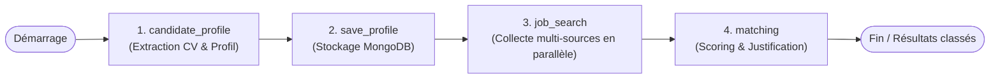

# 💼 AutoApply AI — Intelligent Job Matching & Recommendation

> **Projet PFA IGL4**  
> Système d'analyse de CV, de recherche d'offres d'emploi multi-sources et de matching intelligent basé sur **LangGraph**, **MongoDB (GridFS)** et **Streamlit**.

---

## 📌 Présentation du Projet

**AutoApply AI** est une solution conçue pour optimiser et simplifier la recherche d'emploi et de stage. L'application extrait les informations clés d'un CV au format PDF, recherche en parallèle des offres d'emploi sur plusieurs plateformes (APIs en ligne et base locale), et calcule un score de pertinence précis pour classer les offres les plus adaptées au profil du candidat.

> ℹ️ **Remarque Importante :** Le système fonctionne en **mode recommandation et matching**. Aucune candidature automatique n'est soumise à l'insu du candidat. L'utilisateur dispose de liens directs vérifiés vers les annonces officielles pour postuler manuellement.

---

## 🌟 Fonctionnalités Principales

- **📄 Ingestion & Traitement de CV (PDF) :**
  - Extraction de texte avec `PyMuPDF` (`fitz`).
  - Stockage des fichiers binaires dans **MongoDB GridFS** et métadonnées indexées par empreinte SHA-256.
  - Détection automatique et extraction des informations du candidat (Nom, Email, Téléphone, Compétences clés, etc.) via LLM avec **fallback heuristique instantané** (regex + dictionnaire tech) en cas d'indisponibilité réseau/quota.

- **🌐 Recherche d'Emplois Multi-Sources Parallélisée :**
  - Exécution concurrente via `ThreadPoolExecutor` sur 4 sources complémentaires :
    - **JSearch API (RapidAPI)** : Recherche ciblée par poste et localisation (ex. Tunisie, France, etc.).
    - **Remotive API** : Offres orientées Tech et Remote international.
    - **Arbeitnow API** : Offres d'emploi tech en Europe & télétravail.
    - **Greenhouse API** : Tableaux d'affichage d'entreprises partenaires.
  - **Fallback local** automatique (`data/jobs_for_matching.json`) pour garantir des résultats même hors-ligne.

- **🎯 Matching & Scoring de Pertinence :**
  - **Algorithme heuristique robuste :** Alignement sémantique du rôle recherché (titre + description), ratio de compétences correspondantes et bonus (remote, localisation).
  - **Option Matching LLM :** Analyse sémantique poussée via OpenRouter (`nvidia/nemotron` ou modèle configuré) avec sortie structurée Pydantic.
  - Identification claire des compétences acquises et des compétences manquantes pour chaque offre.

- **💻 Interface Interactive Streamlit :**
  - Design moderne en thème sombre (Glassmorphism & animations CSS).
  - Gestion multi-utilisateurs via `user_id` (compatibilité avec Spring Boot / MySQL).
  - Historique complet des recherches précédentes stockées dans MongoDB.
  - Filtres en temps réel (recherche texte, seuil de score minimal, filtrage par source d'offre).
  - Bouton direct d'accès à l'annonce de recrutement.

---

## 🏗️ Architecture du Pipeline (LangGraph)

Le workflow backend s'appuie sur un graphe d'états orchestré avec **LangGraph** et persisté via `MongoDBSaver` :



1. **`candidate_profile`** : Extrait et normalise le profil à partir du texte extrait du PDF.
2. **`save_profile`** : Enregistre ou met à jour le profil candidat dans la collection `candidate_profiles`.
3. **`job_search`** : Interroge en parallèle les APIs externes et la base locale, dédoublonne et enregistre les offres dans `job_offers`.
4. **`matching`** : Évalue chaque offre vis-à-vis du profil, calcule le score (0-100%) et persiste les résultats dans `match_results`.

---

## 🗄️ Structure de la Base MongoDB

L'application utilise les collections suivantes dans la base (`autoapply_db`) :

| Collection | Rôle |
|---|---|
| `fs.files` / `fs.chunks` | Stockage GridFS des fichiers PDF bruts des CVs. |
| `resumes` | Métadonnées du CV, hash SHA-256, texte extrait et lien vers GridFS. |
| `candidate_profiles` | Profils candidats extraits et préférences associées par `user_id`. |
| `job_offers` | Répertoire d'offres dédoublonnées par `(source, source_id)`. |
| `match_results` | Scores, compétences partagées/manquantes et justifications. |
| `workflows` | Historique et état des exécutions LangGraph (`running`, `completed`, `error`). |

---

## 📁 Structure du Projet

```text
.
├── app.py                      # Interface utilisateur Streamlit
├── backend.py                  # Pipeline LangGraph, connecteurs APIs, GridFS & MongoDB
├── requirements.txt            # Dépendances Python du projet
├── test_upload.py              # Script de test léger pour le téléversement de fichiers
├── .env                        # Variables d'environnement & clés API (non versionné)
├── .gitignore                  # Fichiers et dossiers ignorés par Git
├── data/
│   ├── cvs/
│   │   └── MyCv.pdf            # CV d'exemple pour démonstrations rapides
│   └── jobs_for_matching.json  # Base locale d'offres de secours (fallback)
└── notebooks/                  # Expérimentations et prototypage des agents
    ├── 01_candidate_profile.ipynb
    ├── 02_Job_Search_Agent_V2.ipynb
    ├── 03_matching_agent.ipynb
    └── 04_application_agent.ipynb
```

---

## ⚙️ Prérequis & Installation

### 1. Prérequis Système
- **Python 3.10+** (ou environnement Anaconda / Miniconda recommandé)
- **MongoDB** (installé localement sur `mongodb://localhost:27017` ou cluster distant MongoDB Atlas)

### 2. Cloner le Dépôt & Créer l'Environnement

```bash
# Avec Conda
conda create -n autoapply-ai python=3.11 -y
conda activate autoapply-ai

# Ou avec venv standard
python -m venv venv
# Windows :
.\venv\Scripts\activate
# Linux/Mac :
source venv/bin/activate
```

### 3. Installer les Dépendances

```bash
pip install -r requirements.txt
```

---

## 🔑 Configuration (.env)

Créez un fichier `.env` à la racine du projet (ou complétez celui existant) avec les variables suivantes :

```ini
# --- MongoDB Configuration ---
MONGODB_URI=mongodb://localhost:27017
MONGODB_DATABASE=autoapply_db

# --- OpenRouter (LLM) ---
OPENROUTER_BASE_URL=https://openrouter.ai/api/v1
OPENROUTER_MODEL=nvidia/nemotron-3.5-lightning:free
OPENROUTER_API_KEY_1=votre_cle_openrouter_1
OPENROUTER_API_KEY_2=votre_cle_openrouter_2
OPENROUTER_API_KEY_3=votre_cle_openrouter_3

# --- RapidAPI (JSearch) ---
RAPIDAPI_KEY=votre_cle_rapidapi
RAPIDAPI_HOST=jsearch.p.rapidapi.com

# --- Paramètres Optionnels ---
GREENHOUSE_BOARDS=stripe
MATCH_MIN_SCORE=35
MAX_MATCH_JOBS=25
```

---

## 🚀 Démarrage de l'Application

Assurez-vous que votre instance MongoDB est active, puis lancez le serveur Streamlit :

```bash
streamlit run app.py
```

L'application s'ouvrira automatiquement dans votre navigateur par défaut à l'adresse suivante :
👉 `http://localhost:8501`

### Utilisation pas à pas :
1. Renseignez votre identifiant candidat (`User ID`, ex: `42`).
2. Déposez votre CV au format PDF (ou cochez *"Utiliser le CV démo"*).
3. Définissez vos postes recherchés, votre localisation et vos préférences de recherche.
4. Cliquez sur **"🔎 Analyser le CV et Trouver les Offres"**.
5. Consultez les offres qualifiées, filtrez par score ou source, et cliquez sur **"Consulter l'offre & Postuler"** pour déposer votre candidature sur le site officiel.

---

## 👥 Auteur & Cadre Académique

- **Projet :** Projet de Fin d'Année (PFA) — Ingénierie Logicielle (IGL4 - Semestre 1)
- **Technologies clés :** Python, LangGraph, LangChain, Streamlit, MongoDB, GridFS, OpenRouter, APIs de recrutement.
